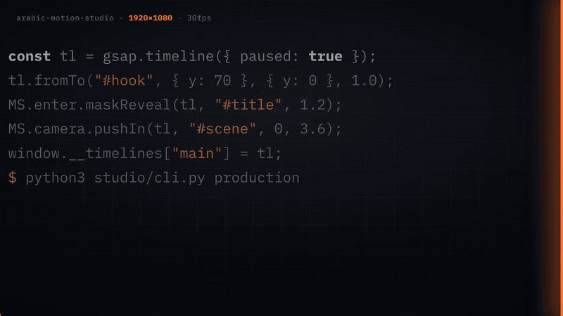

<div dir="rtl">

# Arabic Motion Studio

<p align="center"><a href="assets/intro.mp4"></a></p>
<p align="center"><a href="assets/intro.mp4">شاهد الفيديو كاملا مع الصوت</a></p>

أدوات تجعل وكيل الذكاء الاصطناعي يصنع فيديو موشن جرافيك عربي بجودة يمكن فحصها، لا شرائح مزدحمة بالنص.
مفتوح المصدر، ترخيص Apache 2.0، يعمل على جهازك، بلا اشتراك وبلا مفتاح API.

**الفيديو أعلاه صنع بهذه الأدوات نفسها.** وكيل ذكاء اصطناعي كتب المشاهد والحركة، وخط الإنتاج فحصه وصدره، وإنسان راجعه
قبل النشر. حتى المؤثرات الصوتية مولدة برمجيا، بلا مكتبة أصوات.

[English](README.en.md)

## المشكلة التي يحلها

اطلب من أي وكيل ذكاء اصطناعي أن يصنع فيديو، وغالبا ستحصل على شرائح مليئة بالنص، وتصدير قبل أي مراجعة، وعربية
مقلوبة أو بخط لا يدعمها. Arabic Motion Studio يحول العمل إلى خطوات واضحة يفحص كل منها بالكود قبل أن تخسر وقت
التصدير.

## ماذا يعطيك

- **دليل عمل للوكيل** في `VIDEO_WORKFLOW.md`: من التحقق من المصادر، إلى القصة البصرية لكل مشهد، إلى التصدير
  والمراجعة.
- **بوابات تعمل بالكود.** أمر واحد يمر على ست مراحل، ويوقف التصدير عند أي خطأ مانع حتى يصلح.
- **عربية صحيحة من البداية.** خط Alexandria مضمن، واتجاه من اليمين، وفحص يمنع التشكيل، وقواعد لدمج الكلمات
  الإنجليزية داخل الجملة العربية.
- **ثلاثة قوالب جاهزة:** أخبار تقنية، تعليم أعمال، ووثائقي سينمائي.
- **ثمانية قوالب للمشاهد** وعشر حركات جاهزة، من الصورة الكاملة إلى المقارنة والرقم الكبير.
- **639 اختبارا آليا** تعمل مع كل تعديل على Linux وmacOS.

## التثبيت

الصق هذا في Claude Code:

```
https://github.com/Samix2026/arabic-motion-studio

انسخ هذا المستودع، واقرأ README.en.md، ثم شغل البدء السريع وتأكد أن الفيديو التجريبي يصدر بنجاح.
```

أو يدويا:

```bash
git clone https://github.com/Samix2026/arabic-motion-studio.git
cd arabic-motion-studio
```

لا يوجد ما يبنى. تحتاج Python 3.9 أو أحدث، وNode.js 22 أو أحدث، وFFmpeg، وChrome.

## جرب في خمس دقائق

```bash
mkdir -p videos
cp -R templates/tech-news-ar/examples/grammar-demo-landscape videos/hello
python3 studio/cli.py production videos/hello
```

الأمر يفحص المشروع ثم يصدره ثم يراجع النتيجة. الفيديو يظهر في `videos/hello/renders/video.mp4`.

بعدها افتح المستودع في وكيلك واطلب منه فيديو جديدا يتبع `VIDEO_WORKFLOW.md`. التفاصيل الكاملة، من إنشاء المشروع إلى
سياسة الإصدارات، في [README.en.md](README.en.md).

## ما لا يفعله

- ليس محرك تصدير. HyperFrames من HeyGen هو من يصدر الفيديو، وهذه الأدوات تغلفه بالفحص.
- ليس آليا بالكامل. الوكيل يكتب المشاهد، والإنسان يراجع قبل النشر.
- ليس خدمة أو تطبيقا بواجهة. هو مستودع تنسخه وتعمل داخله.
- القوالب الحالية مصممة للمحتوى العربي، وأغلبها لفيديوهات الأخبار والشرح.

## الترخيص

Apache 2.0. المكونات الخارجية، مثل HyperFrames والخطوط وGSAP، تبقى تحت تراخيصها، والتفاصيل في [NOTICE](NOTICE).

من إعداد سامي المحيميد [@SamiBizConsult](https://x.com/SamiBizConsult). المساهمات مرحب بها، والتفاصيل في
[CONTRIBUTING.md](CONTRIBUTING.md).

</div>
